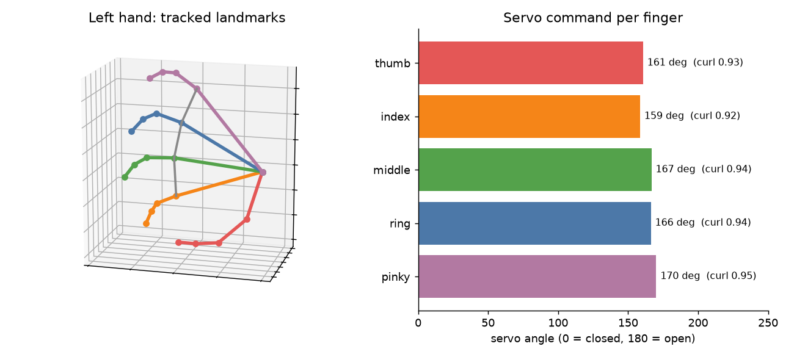

# Vision-Controlled Claw

> **Work in progress.** The vision side works today. The hardware side (driving the claw's servos) is being built and is not in this repo yet.

Control a robotic claw by moving your hand in front of a camera. This repo is the perception side: it tracks a hand with MediaPipe, measures how far each finger is curled, and converts that into a servo angle per finger.



Until the claw is connected, `plot_hand.py` produces the plot above: the tracked hand in 3D and the servo command each finger would receive.

## How it works

1. **Hand tracking** (`src/hand_tracker.py`): MediaPipe's hand landmark model returns 21 3D points per hand for each frame.
2. **Joint angles** (`src/finger_angles.py`): each finger is a chain of four points anchored at the wrist. At each of its three joints, the angle between the two bone segments is computed from the dot product. 180 degrees is straight; smaller is more bent.
3. **Curl**: a finger's three joint angles are averaged into one value from 0.0 (fully curled) to 1.0 (straight).
4. **Servo mapping**: the curl is mapped linearly onto a servo range and clamped. The calibration points are the curl values measured for a closed fist and an open hand, since a real hand never reaches 0.0.

The preview shows the skeleton and, for each finger, the curl and the servo angle it maps to.

## Setup

Python 3.10 or newer.

```bash
python -m venv .venv
source .venv/bin/activate          # Windows: .venv\Scripts\activate
pip install -r requirements.txt
python scripts/download_model.py   # fetches the 8 MB MediaPipe model
```

## Run

```bash
cd src
python main.py                 # webcam
python main.py clip.mp4        # a recorded video
python main.py hand.jpg        # a single image; prints the curl per finger
python main.py clip.mp4 --no-window --save out.mp4
```

`--hands 2` tracks both hands. Press `q` to close the preview.

To plot one frame instead of opening the live preview:

```bash
python plot_hand.py hand.jpg --save plot.png
```

## Tests

The angle math has no MediaPipe dependency and is tested with hand-written coordinates:

```bash
cd src
python test_finger_angles.py
```

## Status

| Part | State |
|---|---|
| Hand tracking, joint angles, curl, servo mapping | Working |
| Hand plot (`plot_hand.py`) | Working |
| Driving the claw's servos | In progress |

The servo calibration values in `servo_angle()` are defaults and need measuring for a specific hand and claw.
