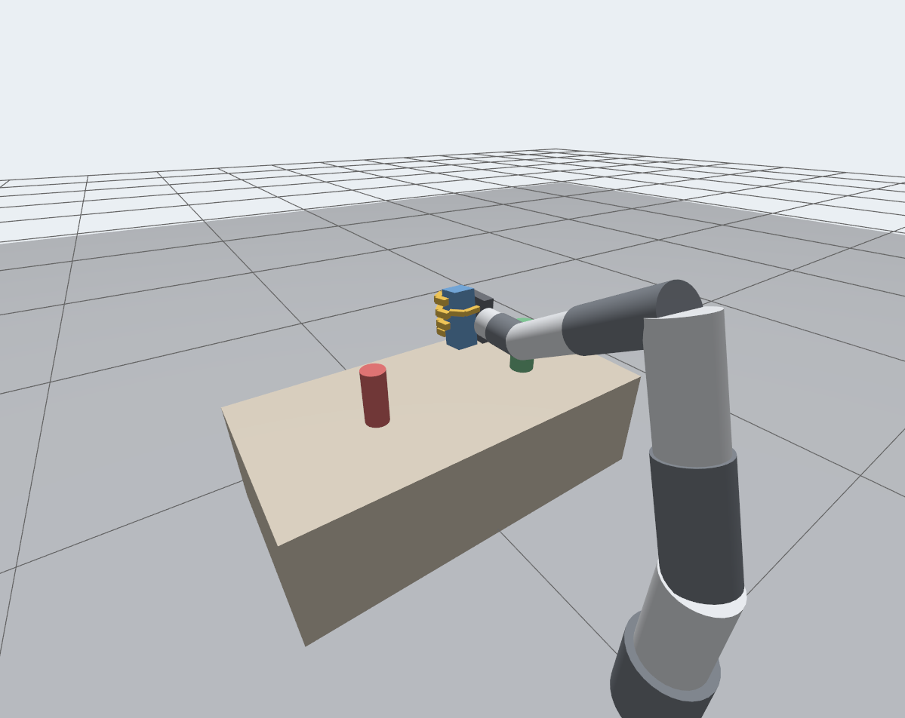

# Vision-Controlled Claw

> **Work in progress.** The vision side works today, and can drive a simulated claw in Gazebo. The hardware side (driving the real claw's servos) is being built and is not in this repo yet.

Control a robotic claw by moving your hand in front of a camera. This repo is the perception side: it tracks a hand with MediaPipe, measures how far each finger is curled, and converts that into a servo angle per finger.


Until the claw is connected, `plot_hand.py` produces the plot above: the tracked hand in 3D and the servo command each finger would receive.

## How it works

1. **Hand tracking** (`src/hand_tracker.py`): MediaPipe's hand landmark model returns 21 3D points per hand for each frame.
2. **Joint angles** (`src/finger_angles.py`): each finger is a chain of four points anchored at the wrist. At each of its three joints, the angle between the two bone segments is computed from the dot product. 180 degrees is straight; smaller is more bent.
3. **Curl**: a finger's three joint angles are averaged into one value from 0.0 (fully curled) to 1.0 (straight).
4. **Servo mapping**: the curl is mapped linearly onto a servo range and clamped. The calibration points are the curl values measured for a closed fist and an open hand, since a real hand never reaches 0.0.

The preview shows the skeleton and, for each finger, the curl and the servo angle it maps to.

## Setup

Python 3.10 or newer.

```bash
python -m venv .venv
source .venv/bin/activate          # Windows: .venv\Scripts\activate
pip install -r requirements.txt
python scripts/download_model.py   # fetches the 8 MB MediaPipe model
```

## Run

```bash
cd src
python main.py                 # webcam
python main.py clip.mp4        # a recorded video
python main.py hand.jpg        # a single image; prints the curl per finger
python main.py clip.mp4 --no-window --save out.mp4
```

`--hands 2` tracks both hands. Press `q` to close the preview.

To plot one frame instead of opening the live preview:

```bash
python plot_hand.py hand.jpg --save plot.png
```

## Simulation

`sim/` holds a Gazebo simulation of the claw: a five-finger hand with one servo per finger, mounted on a 7-joint arm, in front of a table with three objects to pick up.



The tracker drives it live:

| Your hand | The simulated claw |
|---|---|
| Moves left / right / up / down in the image | Moves left / right / up / down |
| Moves towards or away from the camera | Reaches forward or pulls back |
| Turns in the image, like a clock hand | Rolls the same way about the direction it points |
| Each finger curls | The matching finger curls, by that finger's servo angle |

With your fingers pointing straight up, the claw is level with its palm facing left, like a hand held out for a handshake. To pick something up, bring the open claw in from the object's right until the object sits between the thumb and the fingers, close your hand, and lift.

Leaning your hand over turns the claw's wrist. A quarter turn to the left brings the claw palm-down, for coming at something from above; a quarter turn to the right brings it palm-up. The claw can roll 100 degrees either way, and the height it is allowed to drop to changes with the roll so that the hand stays clear of the table.

It needs ROS 2 Jazzy with Gazebo Harmonic (`ros-jazzy-ros-gz`, `ros-jazzy-xacro`, `ros-jazzy-robot-state-publisher`).

```bash
cd sim
colcon build --symlink-install
source install/setup.bash
ros2 launch claw_sim sim.launch.py
```

Then start the tracker with `--sim`, from the venv set up above:

```bash
cd src
python main.py --sim                  # simulation on this machine
python main.py --sim 192.168.1.20     # simulation on another machine
```

A phone works as the camera through an app that streams over Wi-Fi, such as DroidCam. Give the stream's address as the source:

```bash
python main.py http://192.168.1.50:4747/video --sim
```

The two halves talk over TCP port 8765, and the tracker needs no ROS. With the simulation in WSL2, which has no webcam, run the tracker on Windows; `--sim` with no address reaches WSL2 through `127.0.0.1`.

The distance your hand is at when it is first seen becomes the middle of the claw's reach, so start with your hand at a comfortable distance. While no hand is visible, the claw holds still.

To try the simulation without a camera, run a scripted pick-up, which sends the same messages a hand would:

```bash
ros2 run claw_sim demo           # can, block or bottle
```

### How the simulation is put together

- `urdf/hand.xacro` is the claw. Each finger has two or three joints, all driven from that finger's one servo value, as a tendon would. Grip force is limited by the joints' effort limits.
- `urdf/arm7r.xacro` is a generic 7-joint arm, a placeholder for a real one. The arm's kinematics are read from the URDF at start-up, so another 7R arm can replace it as long as it ends in a `tool0` link with z pointing out of the flange. The `seed` parameter of the teleop node then needs a posture for that arm with the claw level and pointing forward.
- `claw_sim/teleop_node.py` receives the tracker's messages, turns the hand's position and roll into a target pose for the claw (`mapping.py`), and solves the arm's joint angles for it 50 times a second (`urdf_chain.py`).

## Tests

The angle math has no MediaPipe dependency and is tested with hand-written coordinates:

```bash
cd src
python test_finger_angles.py
python test_sim_link.py
```

The simulation's kinematics and hand-to-claw mapping are tested without starting Gazebo:

```bash
cd sim/claw_sim
python3 -m pytest test
```

## Status

| Part | State |
|---|---|
| Hand tracking, joint angles, curl, servo mapping | Working |
| Hand plot (`plot_hand.py`) | Working |
| Gazebo simulation of the claw on a 7R arm (`sim/`) | Working |
| Driving the claw's servos | In progress |

The servo calibration values in `servo_angle()` are defaults and need measuring for a specific hand and claw.
